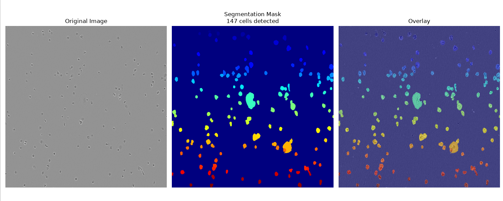
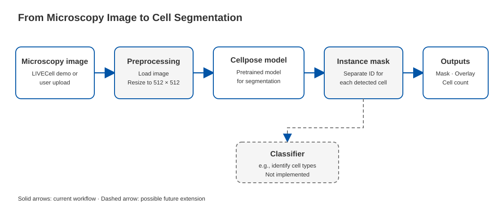

# 🔬 Cell Segmentation with Cellpose

Automated cell detection and segmentation in microscopy images using
[Cellpose](https://github.com/MouseLand/cellpose) — a deep learning model
for cell segmentation.

Built as a portfolio project targeting biotech/pharma computer vision roles.

---

## 📸 Demo



---

## Architecture



The dashed classifier branch is a potential extension and is not implemented in the current app.


## 🧬 Dataset

[LIVECell](https://github.com/sartorius-research/LIVECell) — a large-scale
dataset for label-free live cell segmentation.

- **Cell line used**: A172 (human glioblastoma)
- **Image size**: 1040 × 1408 px
- **Annotation**: ~150 cells per image

---

## 🗂️ Data

A sample image is included in `sample/` — no download needed to try the app.

For the full LIVECell dataset:
\```bash
uv run python download_data.py
\```

> ⚠️ Full dataset is ~500MB and is not included in this repo.

### Data attribution and license

The sample microscopy image comes from the LIVECell dataset by Sartorius. LIVECell data assets are licensed under [Creative Commons Attribution-NonCommercial 4.0 International (CC BY-NC 4.0)](https://creativecommons.org/licenses/by-nc/4.0/).

The sample image is included for demonstration. It has not been modified.

**Note:** The CC BY-NC 4.0 license permits non-commercial use; it does not grant unrestricted commercial use. Check whether your intended use meets the license terms before reusing or redistributing the image.


## 🏆 Results

| Metric | Value |
|---|---|
| Ground truth cells | 150 |
| Detected cells | 149 |
| Recall | 99.3% |
| Model | Cellpose cyto3 |
| Hardware | CPU |

---

## 🚀 Quickstart

### 1. Clone the repo
\```bash
git clone https://github.com/YOURNAME/cell-segmentation.git
cd cell-segmentation
\```

### 2. Install dependencies
\```bash
# Install uv if not already installed
pip install uv

# Install project dependencies
uv sync
\```

### 3. Try with sample image
\```bash
uv run python run_segmentation.py --image sample/sample_cell_image.png
\```

### 4. Download full dataset
\```bash
uv run python download_data.py
\```

### 5. Run the Streamlit app
\```bash
uv run streamlit run app.py
\```

### 6. Or batch process your own images
\```bash
uv run python run_segmentation.py --image data/raw/A172/2.5k/ --batch
\```

---

## 📁 Project Structure

\```
cell-segmentation/
│
├── src/
│   └── cell_segmentation/
│       ├── model.py          # Cellpose model wrapper
│       ├── preprocess.py     # Image loading and preprocessing
│       ├── visualize.py      # Visualization utilities
│       └── __init__.py
│
├── app.py                    # Streamlit web app
├── run_segmentation.py       # CLI for batch processing
├── download_data.py          # Script to download LIVECell dataset
│
├── sample/                   # Sample image for quick testing
├── results/                  # Example segmentation results
├── notebooks/                # Jupyter notebooks
├── data/                     # Full dataset (not in repo)
│
├── pyproject.toml
├── .gitignore
└── README.md
\```

---

## 🛠️ Tech Stack

| Tool | Purpose |
|---|---|
| [Cellpose](https://github.com/MouseLand/cellpose) | Cell segmentation model |
| [Streamlit](https://streamlit.io) | Interactive web app |
| [NumPy](https://numpy.org) | Array processing |
| [Pillow](https://python-pillow.org) | Image preprocessing |
| [Matplotlib](https://matplotlib.org) | Visualization |
| [uv](https://github.com/astral-sh/uv) | Fast Python package manager |

---

## 💡 Key Concepts

- **Instance segmentation** — each cell gets a unique ID
- **Batch processing** — segment entire folders in one command
- **Configurable parameters** — diameter, flow threshold, cell probability
- **CPU/GPU agnostic** — runs on CPU, scales to GPU automatically

---

## 📬 Contact
Made by rosegostner

